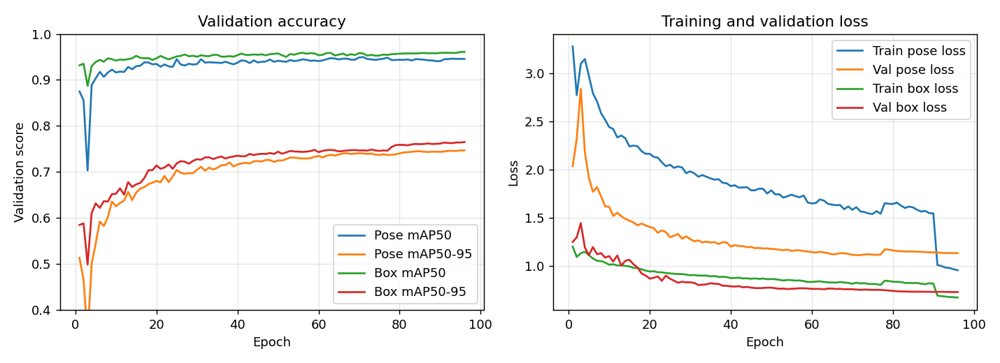

# 3. Metrics for Every Model and Pipeline Stage

This document reports every measurable number for the models and processing stages in EduVision, and says exactly where each number comes from and how far it can be trusted.

**Two evidence files back every figure:**
- `docs/evidence/pose_model_training.json`: the training settings, final scores and per-epoch history **stored inside `best.pt` by Ultralytics during training**. Plotted in `docs/evidence/pose_model_training_curves.png`.
- `docs/evidence/benchmarks.json`: produced by `docs/evidence/run_benchmarks.py`. Re-run it with `python docs/evidence/run_benchmarks.py`, or `ONLY=knn,compose python ...` for single sections.

**Measurement machine:** Windows 11, Python 3.9.13, 12 CPU threads, 12.6 GB RAM, NVIDIA GeForce RTX 2050 (4 GB). PyTorch 2.5.1+cu121, Ultralytics 8.4.180, OpenCV 5.0.0, scikit-learn 1.6.1. Measured on 27 November 2026 with no other EduVision services running.

**Reading the tables:** "mean ± SD (n)" means the mean, standard deviation and number of repeated runs.

---

## 3.1 The Pose Model (`best.pt`, YOLOv8n-pose)

### 3.1.1 What it is

| Property | Value |
|---|---|
| Architecture | YOLOv8n-pose (nano), one class "humanoid", 17 keypoints × (x, y, visibility) |
| Parameters | **3,295,470** |
| File size | **20.09 MB** |
| Trained with | Ultralytics 8.4.140 on Google Colab; saved 5 September 2026 |
| Run name | `varshita_pose_v2-2`, dataset `eduvision_pose_v2_dataset` |
| Licence | AGPL-3.0 (Ultralytics), see [08_SECURITY_PRIVACY_AND_LICENSING.md](08_SECURITY_PRIVACY_AND_LICENSING.md) |

### 3.1.2 Training settings (read from the checkpoint)

| Setting | Value | Setting | Value |
|---|---|---|---|
| Epochs planned / recorded | 100 / 96 | Image size | 640 |
| Batch | 16 | Optimiser | `auto` (chosen by Ultralytics), lr0 = 0.01, lrf = 0.01 |
| Momentum, weight decay | 0.937, 0.0005 | Warm-up | 3 epochs |
| Loss weights | box 7.5, pose **12.0**, kobj 1.0, cls 0.5, dfl 1.5 | Seed | 42 (deterministic) |
| Mosaic / mixup | 0.5 / 0.0 (mosaic off for last 10 epochs) | Flip left–right | 0.5 |
| Translate / scale / rotate | 0.1 / 0.3 / 5° | Random erasing | 0.4 |
| Colour jitter (h, s, v) | 0.015, 0.7, 0.4 | Training time | **1.10 h** for 96 epochs |

The run was **resumed** from an earlier checkpoint of the same project (`varshita_pose_v2-2/weights/last.pt`), which is why the scores are already high at its first recorded epoch.

### 3.1.3 Validation results (final epoch)

| Metric | Box (finding the figure) | Pose (17 keypoints) |
|---|---|---|
| Precision | **0.940** | **0.947** |
| Recall | **0.928** | **0.935** |
| mAP50 | **0.961** | **0.946** |
| mAP50-95 | **0.765** | **0.747** |

Validation losses: box 0.726, pose 1.131, keypoint-objectness 0.006, class 0.425, DFL 1.286.

**How the scores changed over training** (per-epoch history in the JSON):

| Metric | First recorded epoch | Best (epoch) | Last (epoch 96) |
|---|---|---|---|
| Pose mAP50 | 0.875 | 0.950 (71) | 0.946 |
| Pose mAP50-95 | 0.514 | 0.747 (95) | 0.747 |
| Box mAP50 | 0.932 | 0.961 (96) | 0.961 |
| Box mAP50-95 | 0.585 | 0.765 (96) | 0.765 |

Training and validation loss both fall and level off together, with no rising validation loss, so there is **no sign of over-fitting** within the 96 epochs.

**What these numbers mean in plain words:** on the validation drawings, the model found about 93% of the figures. It placed the keypoints close enough to count as correct at the loose 0.5 OKS threshold about 95% of the time, and averaged 0.75 over the strict thresholds 0.50 to 0.95.

### 3.1.4 How far these numbers can be trusted

Both reviewers asked for this, so we state it plainly:

1. **They are validation scores, not test scores.** Ultralytics measures them on the dataset's `val` split, the same split used to choose the best checkpoint. That makes them somewhat **optimistic**. No separate, untouched test set was scored.
2. **The dataset size and source are not in the checkpoint.** Textbook chapter 3 describes an earlier dataset of 1,200 images (960/180/60). The final model used `eduvision_pose_v2_dataset`, whose exact size and makeup we could not recover from the repository. The training data was prepared from Meta's Amateur Drawings dataset (textbook chapters 2 and 5).
3. **There is no baseline comparison** (an off-the-shelf COCO YOLOv8-pose, or Meta's original detector on the same images), and **no ablation** of padding augmentation.

How to close these gaps is in §3.7.

### 3.1.5 Speed of the pose model

| Measurement | Result |
|---|---|
| Load `best.pt` | 3.67 s (one time per process) |
| One drawing, **GPU** (RTX 2050) | **13.7 ± 7.0 ms** (n = 30), median 12.1 ms |
| One drawing, **CPU** | **67.3 ± 5.3 ms** (n = 30), median 66.6 ms |

The six family drawings were each run 5 times after 2 warm-up calls. The GPU is about **4.9×** faster. Either way, the model is a tiny part of the total time (see §3.3).

---

## 3.2 Behaviour on 178 Real Uploaded Drawings (No Labels)

`eduvision_ui/uploads/` holds every drawing uploaded while the system was developed and tested: **178 images** of children's-style drawings, family characters and test sketches. They have **no ground-truth labels**, so this section measures *behaviour*, not accuracy.

| Measure | Result |
|---|---|
| Drawings with at least one figure found | **156 / 178 = 87.6%** |
| No figure found | 22 (the system then uses the whole image as the box) |
| More than one figure found | 4 (the most confident one is used) |
| Confidence of the chosen figure | 0.864 ± 0.091, median 0.896, lowest 0.365 |
| Mean keypoint visibility score | 0.994 ± 0.013 |
| Keypoints with visibility > 0.5 (out of 17) | 16.97 ± 0.23 (minimum 15) |
| Mask area as a share of the crop | 0.420 ± 0.127 (lowest 0.0002) |

**Interpretation:**
- About **1 drawing in 8 is not detected** at all. Those are the main candidates for the Fixer, and for future training data.
- The model almost always marks all 17 keypoints as visible. **That does not mean they are in the right place**: the visibility head is confident even when the pose is wrong. This is why the Fixer exists.
- At least one mask covered almost nothing (0.02% of the crop), which is a segmentation failure. Masks are inspected in the Fixer before animation.
- The uploads include repeated test images, so these rates describe our test traffic, not a random sample of children.

---

## 3.3 Speed of Every Pipeline Stage

### 3.3.1 Preparing one drawing (detection + segmentation + skeleton)

| How it is run | Time |
|---|---|
| **Cold:** a new Python process per drawing (the old way, and the fallback when the AI server is off) | **28.1 ± 3.0 s** (n = 3) |
| **Warm:** models already loaded (what `ai_server.py` does) | **1.32 ± 0.05 s** (n = 5) |

So keeping the models loaded makes this step **about 21× faster**. The cold time is almost all start-up and model loading: the model itself needs only 0.014 s (§3.1.5).

> This independently re-measures the textbook's earlier "27.84 s → 0.37 s" claim. Our cold number (28.1 s) matches; the warm number is larger (1.32 s) because it includes rembg segmentation and writing the output files, not just the detection call. The AI server **is** now part of the deployed system (`start-eduvision.bat` starts it on port 5001).

### 3.3.2 Animating one motion (warm engine, 90-frame cap, 320 px render copy)

| Motion | Time (n = 3) | GIF frames* | GIF size |
|---|---|---|---|
| idle | 2.47 ± 0.15 s | 90 | 1,518 KB |
| wave | 2.34 ± 0.12 s | 90 | 1,506 KB |
| jump | 2.38 ± 0.05 s | 79 | 1,313 KB |
| sleep | 2.34 ± 0.03 s | 41 | 602 KB |
| opening | 2.37 ± 0.05 s | 90 | 1,421 KB |
| walk in circle | 2.48 ± 0.15 s | 90 | 1,468 KB |

\* The GIF writer merges identical consecutive frames, so a motion with still moments (sleep, the end of jump) stores fewer than 90 frames. All 90 are still rendered.

### 3.3.3 Frame-cap ablation (the 90-frame limit on its own)

The same character and engine, changing **only** the frame cap:

| Motion | Frames rendered | Time (n = 2) | GIF size |
|---|---|---|---|
| wave | 90 | 2.31 ± 0.02 s | 1.5 MB |
| wave | **839 (all)** | **9.23 ± 0.01 s** | **13.8 MB** |
| jump | 90 | 2.39 ± 0.01 s | 1.3 MB |
| jump | **250 (all)** | **3.83 ± 0.11 s** | 1.3 MB |

From these, the cost is about **1.5 s of setup plus 9.2 ms per frame** (derivation in [02_MATHEMATICAL_FOUNDATIONS_AND_PROOFS.md](02_MATHEMATICAL_FOUNDATIONS_AND_PROOFS.md) §2.10). On a warm engine, the cap therefore saves **4×** time on the wave but only **1.6×** on the 250-frame motions.

This answers the reviewers' question about separating the causes. The very large old times (9–12 minutes for six characters) came mostly from **starting a new process and rebuilding the mesh for every motion**, not from the number of frames (chapter 14 §6.2).

**Quality cost of the cap:** it keeps 3.0 s of a 250-frame motion (36%) but only 0.75 s of the wave (11%), and the wave then plays 2.4× slower than recorded (§2.10).

### 3.3.4 Building the story video

| Measurement | Time |
|---|---|
| `compose_story.py`, nine scenes, 1280 × 720, 24 fps, 23.75 s video | **14.5 ± 1.9 s** (n = 3) |

### 3.3.5 End to end (from textbook chapter 14, one measured run)

| Task | Before (Nov 2026 re-measure) | Now |
|---|---|---|
| Six characters uploaded together, all ready | ~123 s | **50.3 s** |
| Story video | 89–124 s | **15.8 s** (14.5 ± 1.9 s in §3.3.4) |

The end-to-end upload figure is **a single run** (n = 1). It should be repeated before it is quoted with confidence.

---

## 3.4 Handwritten-Digit Model (k-NN, Count & Play)

**Data:** `digits_knn.json` contains the 1,797 samples of scikit-learn's `load_digits` dataset (UCI Optical Recognition of Handwritten Digits), 64 features each, with 174 to 183 samples per digit.

**Method:** 10-fold stratified cross-validation (shuffled, seed 42) with the **same rule the game uses**: distance-weighted k-NN.

| k | Accuracy | Macro F1 |
|---|---|---|
| 1 | 98.94% | 0.989 |
| **3 (used)** | **98.94%** | **0.989** |
| 5 | 98.61% | 0.986 |
| 7 | 98.61% | 0.986 |

**Recall per digit (k = 3):**

| Digit | 0 | 1 | 2 | 3 | 4 | 5 | 6 | 7 | 8 | 9 |
|---|---|---|---|---|---|---|---|---|---|---|
| Recall | 100% | 100% | 99.4% | 98.9% | 100% | 97.8% | 100% | 99.4% | 98.3% | **95.6%** |

**Most common confusions:** 9 → 3 (3 times), 8 → 1 (3 times), 5 → 9 (3 times), 3 → 7 (2 times). The full confusion matrix is in `benchmarks.json` → `knn.k3_confusion_matrix`.

**Caveat:** this is accuracy **on the training dataset's own handwriting**, which came from adults. A child writing with a finger on a screen produces different shapes, so real accuracy in the game will be lower and has **not** been measured. That is why the game also offers a number keypad.

---

## 3.5 Segmentation (rembg + OpenCV)

There are **no labelled masks**, so no IoU or Dice score can be computed yet. What is known:
- On the 156 detected uploads, masks covered 42% ± 13% of the figure's box (§3.2), which is reasonable for a figure drawn inside its box.
- One clear failure (a mask of 0.02% of the box) was found.
- The rembg step is slow and variable: 1.3 s in some runs and 5.5 s in others, without code changes (chapter 14 §7). It runs on the CPU.

How to measure it properly is in §3.7.

---

## 3.6 Platform Software Tests

| Suite (platform/api/tests) | What it checks |
|---|---|
| `api.test.js` | Health, login, permissions, classes, student story boundaries |
| `integration.test.js` | Launch tokens, result submission, forged-assignment rejection |
| `logging.test.js` | Request IDs, error format, tokens hidden in logs |
| `onboarding_simplification.test.js` | Parent creates child, enrolment, passwordless login, two classes allowed |
| `story_video_security.test.js` | Who may stream which video, path traversal, byte ranges |
| `data_integrity.test.js` | Class-scoped assignments, cross-class launch refused, delete rules, bulk enrolment |

**Result on 27 November 2026:** **53 of 53 tests pass** (6 suites, 7.9 s). The tests use a separate `eduvision_test` database, so they never touch real data.

Manual pipeline tests (UT/CT/IT/ST in the presentation): 16 of 17 pipeline cases pass. **UT_1.11 fails**: the mesh tears when arms cross the chest.

---

## 3.7 What Is Not Measured Yet, and How to Measure It

| Gap | Proposed measurement | Effort |
|---|---|---|
| Pose accuracy on an untouched test set | Label 100–200 **real** children's drawings (never used in training); report OKS-mAP50, mAP50-95 and PCK@0.2 per joint | 1–2 weeks of labelling |
| Baselines | Run COCO YOLOv8n-pose and Meta's original detector on the same set | 1 day |
| Padding-augmentation ablation | Retrain with the same seed and settings, with and without padding; compare on the same test set | 2 Colab sessions |
| Segmentation | Hand-draw masks for 50 drawings; report IoU and Dice for rembg alone, threshold alone and hybrid | 3–4 days |
| Fixer usefulness | Share of drawings needing a fix, seconds per fix, edits per fix | Log it in the Fixer |
| Animation quality | Two or three raters score limb continuity, shape and smoothness (1–5) on 30 drawings × 6 motions; report agreement (Cohen's κ) | 1 day |
| Classroom load | 30 simultaneous uploads; report p50/p95 time and peak memory | Half a day |
| Children's digit accuracy | Collect 200 digits written by children (with consent) | With the pilot study |
